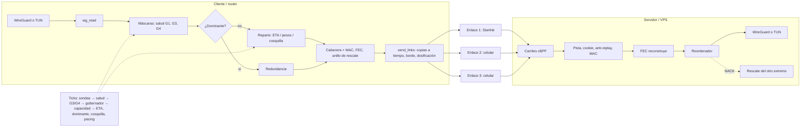

# Mapa del motor

El motor de cengarde (`engine/src`, C) lleva un túnel por varios enlaces a la vez: el **cliente** (un router con Starlink y módems celulares) y el **servidor** (un VPS). Cada extremo decide por qué enlaces manda lo suyo (el cliente la subida, el servidor la bajada) y reordena lo que recibe. Esta nota es la entrada: el camino de un paquete, el orden de los ticks y la lista de piezas. Leído del árbol en la rama `claude/starlink-gears` (2026-10-21).

## El camino de un paquete

### Subida (cliente → servidor)
1. WireGuard local (o la TUN con `tunnel = native`) entrega un lote; `wg_read` lo lee. En nativo, [[Flujos (flow.h)]] y [[Liberación TCP (tcpfree.h)]] marcan los ACK y las retransmisiones.
2. Las máscaras del lote: portadores de [[Salud y silenciado (health.h)]] (G1), elegibles de [[G3 enlace sin respuesta (split.h)]] y la guarda [[G4 guarda de dispersión (split.h)]].
3. Por paquete: [[Copias bajo estrés (split.h)]] y el tope de [[FEC (fec.h)]] recortan; si hay un [[Enlace dominante (dominant.h)]], va como en redundancia; si no, el [[Reparto (split.h)]] elige enlace con el [[ETA (eta.h)]] (o por pesos del [[Gobernador (govern.h)]] o de la [[Capacidad (capacity.h)]]), primero la [[Cosquilla (tickle.h)]].
4. Cabecera, secuencia y MAC una vez ([[Camino del router (clientpath.h)]]); se suma a un grupo de [[FEC (fec.h)]] y se guarda para el [[Rescate (rescue.h)]].
5. `send_links` manda por cada enlace: las [[Copias a tiempo (eta.h)]], las copias del borde ([[Ranuras de Starlink (slot.h)]]) y lo que sobra a los enlaces que no son el primero ([[Lo que sobra (spare.h)]]: copias parciales o paridad) deciden qué copias salen; el socket va dosificado ([[Dosificación (pace.h)]]), desde la [[Dirección de origen (addrpick.h)]] hacia la dirección de la [[Elección de servidor (srvpick.h)]] ([[Nombres del servidor (resolve.h)]]).
6. En el VPS, el kernel deja cada datagrama en el carril de su enlace ([[Colas del servidor (steer.h)]], con el [[Presupuesto de recepción (rcvbudget.h)]]).
7. El servidor halla la clave por la pista ([[Varios clientes (clients.h)]]), acepta caminos nuevos solo con cookie ([[Cookies y HELLO (cookie.h)]]), mira el [[Anti-replay (replay.h)]] antes del MAC y marca después; anota en [[Llegadas (arrival.h)]] y [[Tamaños (wgsize.h)]].
8. [[FEC (fec.h)]] y los [[Códigos de borrado (rs.h, rlc.h)]] reconstruyen lo que pueden; el [[Reordenador (reorder.h)]] pone en orden y pide los huecos al [[Rescate (rescue.h)]] del cliente; sale a WireGuard o a la TUN ([[Rutas del túnel nativo (tunroute.h)]], que comprueba el origen).

### Bajada (servidor → cliente)
1. `wg_read` o `tun_read` del servidor ([[Rutas del túnel nativo (tunroute.h)]] elige la sesión); `down_prepare` usa las mismas piezas que el paso 2–4 de la subida, con la salud y la capacidad medidas en este sentido y el tipo de cada camino que mandó el cliente ([[Modelo de enlace (linkmodel.h)]]).
2. `down_send` sale por el carril de cada camino, dosificado ([[Dosificación (pace.h)]]), desde la [[Dirección de llegada (pktinfo.h)]].
3. En el router, las bombas o el bucle leen los sockets ([[Hilos por enlace (thrplan.h)]]); [[Camino del router (clientpath.h)]] juzga cada datagrama ([[Eco de sondas (epoch.h)]], [[Anti-replay (replay.h)]]).
4. El [[Reordenador (reorder.h)]] del cliente entrega en orden y pide (NACK) al [[Rescate (rescue.h)]] del servidor. Si WireGuard del VPS ignora al router, [[Reloj atrasado de WireGuard (wgwatch.h)]].

### Los ticks (~10 por segundo, cada extremo)
[[Sondas y cola de bonding (proto.h)]] traen las medidas → `health_tick`: [[Modelo de enlace (linkmodel.h)]] → [[Salud y silenciado (health.h)]] → `spread_tick` ([[G3 enlace sin respuesta (split.h)]], [[G4 guarda de dispersión (split.h)]]) → `gov_tick` ([[Gobernador (govern.h)]]) → `cap_tick` ([[Capacidad (capacity.h)]], [[Tope para cake (capacity.h)]], [[Enlace dominante (dominant.h)]], [[ETA (eta.h)]], [[Cosquilla (tickle.h)]], [[Dosificación (pace.h)]], [[Lo que sobra (spare.h)]]). Todo cambio va a la [[Bitácora de decisiones (decision.h)]]. Casi todo cuelga de un solo sensor: [[Cola por enlace (cg_gov_base)]].

## Piezas por grupo

- **Medir:** [[Sondas y cola de bonding (proto.h)]], [[Salud y silenciado (health.h)]], [[Cola por enlace (cg_gov_base)]], [[Capacidad (capacity.h)]], [[Tope para cake (capacity.h)]], [[Ranuras de Starlink (slot.h)]], [[Flujos (flow.h)]].
- **Decidir:** [[Modelo de enlace (linkmodel.h)]], [[Gobernador (govern.h)]], [[Reparto (split.h)]], [[G3 enlace sin respuesta (split.h)]], [[G4 guarda de dispersión (split.h)]], [[Copias bajo estrés (split.h)]], [[ETA (eta.h)]], [[Copias a tiempo (eta.h)]], [[Lo que sobra (spare.h)]], [[Cosquilla (tickle.h)]], [[Enlace dominante (dominant.h)]].
- **Enviar:** [[Dosificación (pace.h)]], [[Liberación TCP (tcpfree.h)]], [[Elección de servidor (srvpick.h)]], [[Dirección de origen (addrpick.h)]], [[Dirección de llegada (pktinfo.h)]], [[Nombres del servidor (resolve.h)]].
- **Recibir:** [[Camino del router (clientpath.h)]], [[Anti-replay (replay.h)]], [[Reordenador (reorder.h)]], [[Colas del servidor (steer.h)]], [[Presupuesto de recepción (rcvbudget.h)]], [[Hilos por enlace (thrplan.h)]], [[Eco de sondas (epoch.h)]], [[Cookies y HELLO (cookie.h)]], [[Varios clientes (clients.h)]], [[Rutas del túnel nativo (tunroute.h)]].
- **Recuperar:** [[Rescate (rescue.h)]], [[FEC (fec.h)]], [[Códigos de borrado (rs.h, rlc.h)]], [[Lo que sobra (spare.h)]], [[Reloj atrasado de WireGuard (wgwatch.h)]].
- **Configurar:** [[Configuración (config.c)]], [[Perillas]], [[Tabla de reenvío (fwdtable.h)]].
- **Observar:** [[Llegadas (arrival.h)]], [[Tamaños (wgsize.h)]], [[Bitácora de decisiones (decision.h)]].
- **Otros:** [[Utilidades]], [[Glosario]].

Fuera del mapa: [[engine-README]] (perillas con medidas), [[ROADMAP]], [[012-bonding]], [[013-capacidad-y-dosificacion]], [[015-modelo-de-enlace]], [[020-copias-parciales-y-paridad]], [[audit-pending]] (la auditoría de relojería: `~/campo/2026-10-17/relojeria/analysis.md`, fuera del vault).

## Contradicciones

Entre el código, sus comentarios y las historias (2026-10-21):
- `reorder.h` dice «la ventana, N = 4096, queda bajo la anti-replay (8128)»; el código tiene `CG_RO_SLOTS` 16384 y `CG_REPLAY_BITS` 32768 (PR #46, [[013-capacidad-y-dosificacion]]; [[engine-README]] ya dice 16384). `replay.h` también habla de «8129 a 8255 secuencias».
- `proto.h` empieza con «protocol, version 5»; `CG_PROTO_VERSION` es 7 (FEC). `steer.h` habla de «cengarde protocol 4» para el socket de basura.
- `slot.h`: 477 ranuras en 1,7 h; [[015-modelo-de-enlace]] (TL;DR): 479 ranuras en 2 h.
- `arrival.h`: «ninguna decisión lo lee»; `reorder_idle_ms` (experimento C2) usa `cg_arr_idle` para el `rset` del reordenador.
- [[engine-README]]: el peso del rescate y el sondeo de `capacity_weights` se describen con `governor_target_ms`; desde C12 son `rescue_target_ms` y `capacity_sat_ms` (mismo valor por omisión). Dice que `pacing` es del cliente, pero el servidor también dosifica sus carriles (`pace.h`, `pace_lanes`). Para `split_dominant_hold` da «0 apagado, 1 sí»; `config.h` dice «0 el del preset, 1 sí, 2 no».
- `config.h` marca `rescue_kb` y `rescue_pct` como «server:», pero el cliente también guarda un anillo para la subida.
- `dominant.h` ubica `pace_peers_ms` en `eta.h`; vive en `linkmodel.h`.
